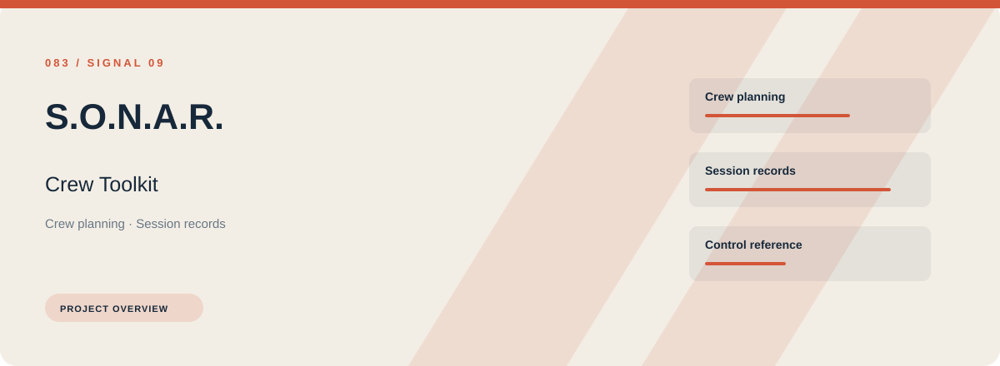
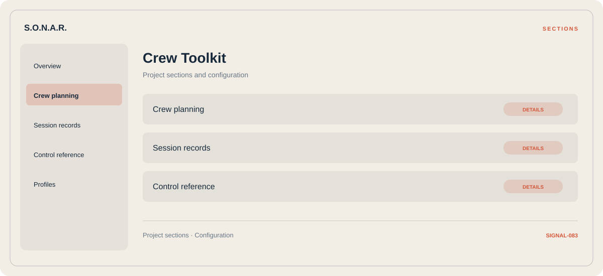

# 🧭 S.O.N.A.R. Crew Toolkit

**Crew planning · Session records · Control reference**

## ⚡ Features

S.O.N.A.R. Crew Toolkit focuses on three connected areas: crew planning, session records, control reference. Its organization keeps frequently used options close to the context they belong to.

### ⚙️ Crew planning

Character or team groups presented with the context needed to organize a session.

### 🧩 Session records

Session and activity information grouped by the task or context it belongs to.

### ⌨️ Control reference

A dedicated section for control reference and the configuration details associated with that area.

## 🖥️ Project navigation

## 📥 Download

The button and cover open the project's download page. Use the information supplied with the downloaded package for installation and release-specific requirements.

## 📚 Project documentation

- [Feature reference](docs/FEATURES.md)
- [Download information](docs/DOWNLOAD.md)
- [Project page](index.html)

---

S.O.N.A.R. Crew Toolkit · Program documentation and download information.
